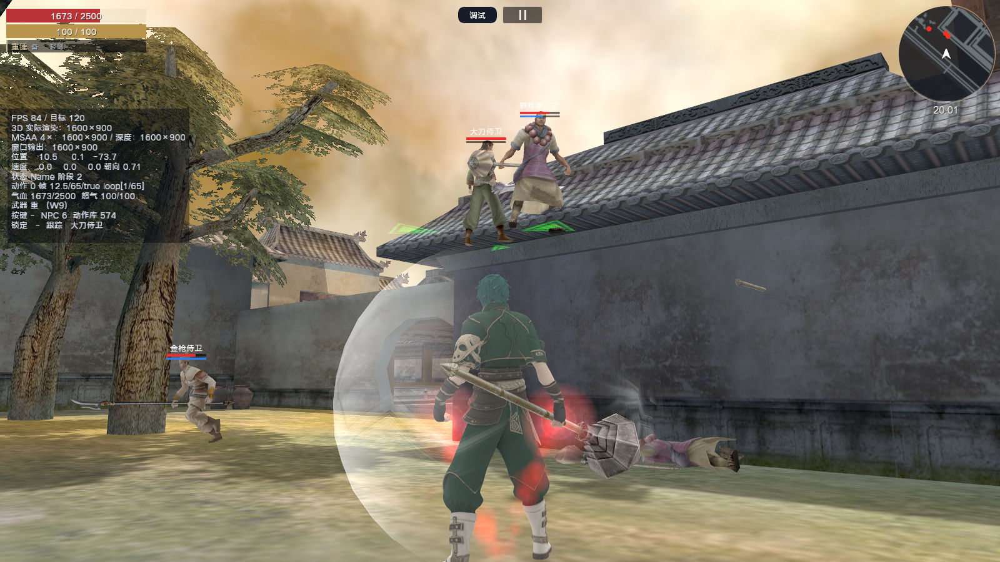
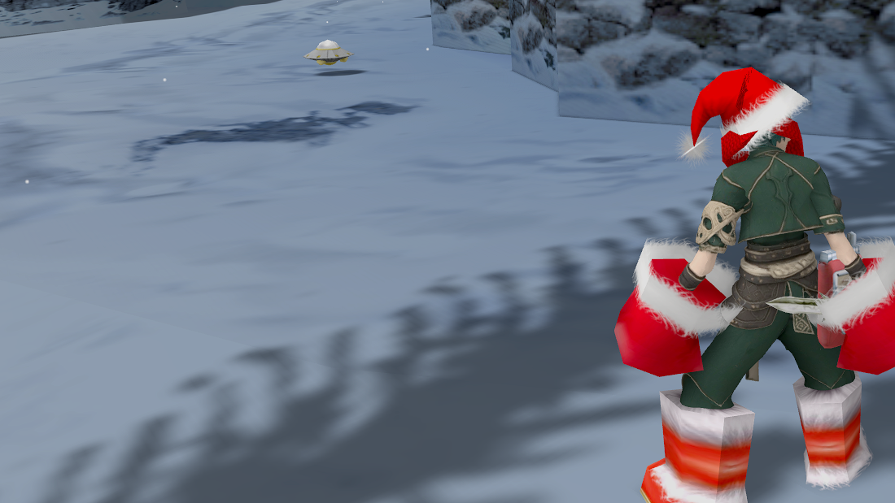
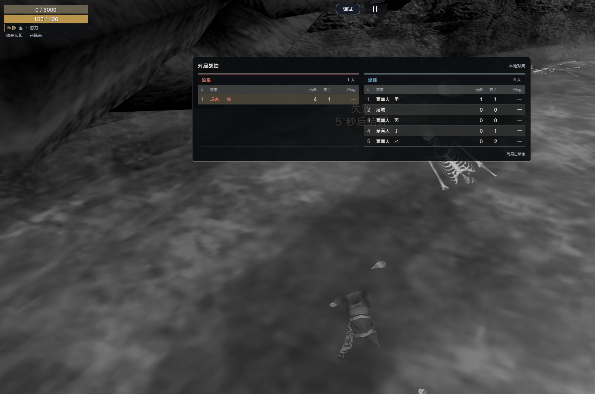
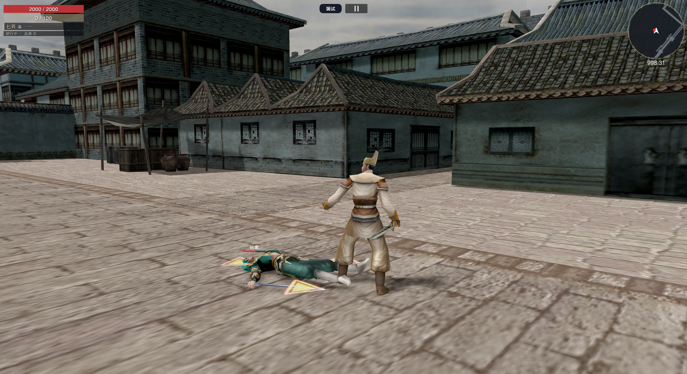

# OpenMeteor

[简体中文](README.md) | **English**

An open-source Rust and Bevy reimplementation of **Meteor Butterfly Sword (流星蝴蝶剑)**.

OpenMeteor explores the original game's combat, movement, animation, scene logic,
and multiplayer protocols through a modular Rust workspace. It includes a native
desktop client and a dedicated server. The project is under active development;
gameplay coverage and compatibility are incomplete.

## Video introduction

[▶ Watch the project introduction on Bilibili](https://www.bilibili.com/video/BV1HceY6nEbx/)

## Screenshots

These screenshots show the game running with game resources, which must be provided separately.

| Courtyard combat | Snow scene |
| --- | --- |
|  |  |
| **Match results** | **Town scene** |
|  |  |

## What is included

- Modular gameplay systems for combat, physics, input, AI, and scene scripting.
- Asset readers, animation support, and resource-loading infrastructure.
- A Bevy desktop client, multiplayer networking, and a Rust server.
- Rust entry crates for Android and WebAssembly.
- Vendored rendering patches and automated tests that can run without game data.

This is a source distribution. Original game data, executables, audiovisual
assets, deployment settings, signing material, and prebuilt binaries are not
included. Building the software does not require an original game installation.
Playing it requires compatible resources that you are entitled to use.

## Build

Requirements:

- Rust stable, installed with rustup (validated with Rust 1.97.1).
- A native C/C++ linker and the system libraries required by Bevy.
- Sufficient disk space for Bevy's build dependencies.

```sh
git clone https://github.com/nantianz/OpenMeteor.git
cd OpenMeteor/meteor_rust
cargo build --workspace --locked
```

Build the desktop client or server separately:

```sh
cargo build --locked -p meteor-app --bin meteor
cargo build --locked -p meteor-server
```

For an optimized build:

```sh
cargo build --locked -p meteor-app --bin meteor --release
```

## Resources and desktop usage

The desktop client accepts a read-only original installation or compatible MPK
resource packs. Neither is distributed here. The bundled launcher uses a Bevy
fallback font and transparent artwork placeholders; complete launcher visuals
and Chinese glyph coverage require suitable replacement UI assets and fonts.

```sh
cargo run --locked -p meteor-app --bin meteor -- --help
cargo run --locked -p meteor-app --bin meteor -- --original-dir /path/to/game --check-resources
cargo run --locked -p meteor-app --bin meteor -- --original-dir /path/to/game
```

For existing resource packs, set `METEOR_PACKS_DIR` to a directory containing
`packs.json` and its pack files, or place `packs/` beside the executable.

Precomputed scene normals and water textures are not bundled. The desktop client
can generate water data at runtime from the scene resources you provide. HD
normal maps require a separate compatible resource pack.

## Multiplayer

The native client defaults to `ws://127.0.0.1:9001`. Run your own server:

```sh
cargo run --locked -p meteor-server
```

The server reads its listening port from `PORT`. Set `METEOR_WS` to use a different
WebSocket endpoint. No hosted game service or TURN credentials are bundled.

Native WebRTC uses public STUN services by default. An optional TURN relay is
configured at runtime with `METEOR_TURN_URLS`, `METEOR_TURN_USERNAME`, and
`METEOR_TURN_PASSWORD`. URLs are comma-separated. Keep credentials outside source
control. Optional build-time route candidates use `METEOR_PRIMARY_WS` and
`METEOR_SECONDARY_WS`.

## Windows releases

Pushing a `v*` tag in the OpenMeteor repository starts the `Windows release`
workflow. It builds x64 and x86 clients sequentially and publishes both ZIPs and
their SHA-256 checksums to the matching GitHub Release. For example:

```sh
git tag v0.1.0
git push origin v0.1.0
```

Publication waits for both architectures to build and package successfully. Tags
containing `-` are prereleases; a complete published version skips compilation
and keeps its existing files. Manual runs can select x64, x86, or both and produce artifacts retained for
one day, without creating a Release.

The workflow only compiles, packages, and publishes the client; it does not run
unit tests. One Windows job builds sequentially with two compiler processes,
optimizations enabled, and LTO, debug information, and incremental compilation
disabled. Only dependency downloads are cached. Each target directory is removed
after packaging, and the job has a five-hour timeout.

ZIPs contain `OpenMeteor.exe`, configuration, a launcher, and license notices.
Original game resources and optional DLSS/ANGLE runtimes are not included.
Extract the complete ZIP and drag an original game directory onto
`Start-OpenMeteor.cmd`, or launch with `--original-dir`. A suitable Chinese font
can be provided as `fonts/ui.ttf` in the original game directory.

## Tests

From the repository root:

```sh
cd meteor_rust
cargo test --workspace --locked
```

Tests that require original game files or separate reference captures are gated
behind `original-assets`. Enabling this feature requires providing the matching
resources and fixtures locally; they are excluded from this source distribution.

This update passed the workspace build and default tests on macOS with Rust
1.97.1 (1146 passed, 2 ignored), plus a compilation check of the separate
WebAssembly crate:

```sh
rustup target add wasm32-unknown-unknown
cargo check --manifest-path crates/meteor-wasm/Cargo.toml --target wasm32-unknown-unknown --locked
```

These checks do not establish full gameplay parity. Android, Windows, and browser
runtime behavior still need validation on their respective platforms.

## Workspace

| Crate | Responsibility |
| --- | --- |
| `meteor-core` | Shared data and game rules |
| `meteor-asset` | Resource formats and loading |
| `meteor-anim` | Animation data and playback |
| `meteor-combat` | Combat and status effects |
| `meteor-physics` | Movement and collision |
| `meteor-scene` | Scenes and mission scripts |
| `meteor-ai` | AI behavior |
| `meteor-input` | Input mapping |
| `meteor-network` | Protocols and multiplayer state |
| `meteor-app` | Bevy client and desktop executable |
| `meteor-server` | Dedicated server |
| `meteor-android`, `meteor-wasm` | Platform entry crates |

## Contributing

Bug reports and focused pull requests are welcome. Include reproduction steps
and relevant automated checks. Keep credentials, personal configuration, and
original game data out of contributions. Discuss changes to gameplay behavior
with reproducible evidence whenever possible.

## License

OpenMeteor project code is licensed under **GNU GPL version 3 only**. See
[LICENSE](LICENSE). Third-party dependencies retain their own licenses; see
[THIRD_PARTY_NOTICES.md](THIRD_PARTY_NOTICES.md).

This is an independent fan project. The original game's data and trademarks
remain the property of their respective rights holders. This repository's
software license does not grant rights to those assets.
