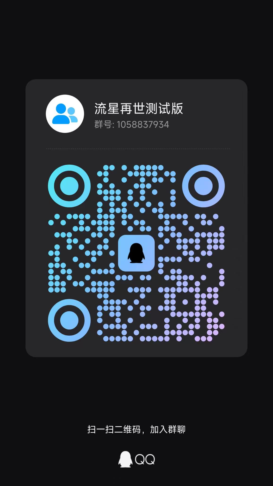
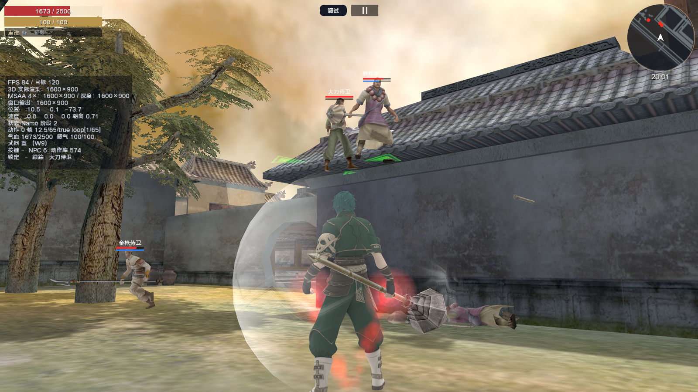
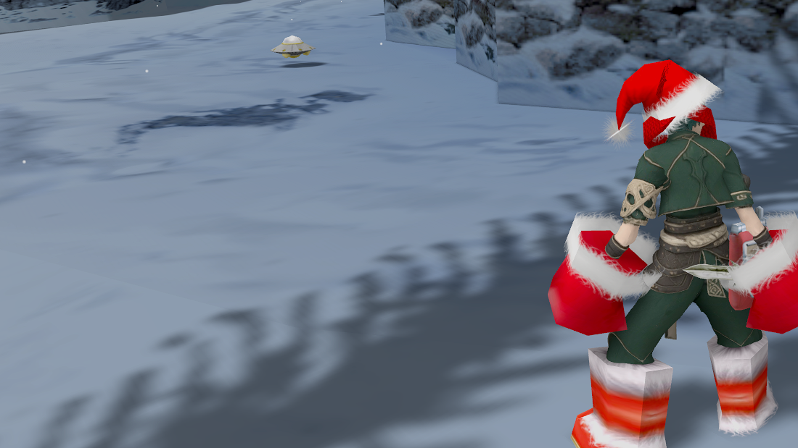
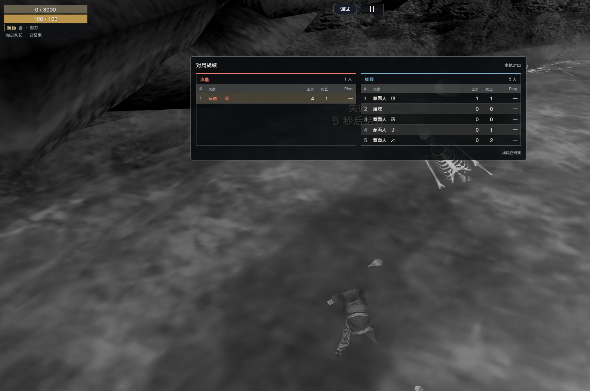
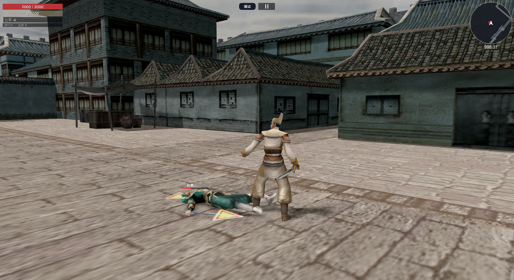

# OpenMeteor

**简体中文** | [English](README.en.md)

基于 **Rust 和 Bevy** 的《流星蝴蝶剑》开源重实现。

OpenMeteor 通过模块化的 Rust 工程探索原版游戏的战斗、移动、动画、场景逻辑和多人联机协议，包含原生桌面客户端与独立服务器。项目仍在开发中，玩法还原和兼容性尚未完整覆盖。

## 视频介绍

[▶ 在 Bilibili 观看项目介绍视频](https://www.bilibili.com/video/BV1HceY6nEbx/)

## QQ 交流群

**流星再世测试版** · 群号 `1058837934`

在 QQ 中搜索群号，或扫描下方二维码加入。

<a href="docs/images/qq-group.jpg"></a>

## 游戏截图

截图展示搭配游戏资源运行时的画面；游戏资源需自行准备。

| 庭院战斗 | 雪地场景 |
| --- | --- |
|  |  |
| **对局战绩** | **城镇场景** |
|  |  |

## 项目内容

- 战斗、物理、输入、AI 和场景脚本等模块化玩法系统。
- 资源格式解析、动画支持与资源加载基础设施。
- Bevy 桌面客户端、多人联机功能与 Rust 服务器。
- Android 和 WebAssembly 的 Rust 入口 crate。
- 随源码维护的渲染补丁，以及无需游戏数据即可运行的自动化测试。

本仓库发布源代码，不包含原版游戏数据、可执行文件、音视频素材、部署设置、签名材料或预编译程序。编译软件不需要安装原版游戏；运行游戏需要自行准备有权使用的兼容资源。

## 编译

环境要求：

- 通过 rustup 安装的 Rust stable，已使用 Rust 1.97.1 验证。
- 本机 C/C++ 链接器，以及 Bevy 所需的系统库。
- 足够存放 Bevy 构建依赖和产物的磁盘空间。

```sh
git clone https://github.com/nantianz/OpenMeteor.git
cd OpenMeteor/meteor_rust
cargo build --workspace --locked
```

也可以分别编译桌面客户端和服务器：

```sh
cargo build --locked -p meteor-app --bin meteor
cargo build --locked -p meteor-server
```

构建经过优化的发布版本：

```sh
cargo build --locked -p meteor-app --bin meteor --release
```

## 资源与桌面运行

桌面客户端支持只读加载原版游戏安装目录，或加载兼容的 MPK 资源包；这两类资源均未随仓库分发。启动 Logo、主界面标题与背景、战役地图和光晕随源码提供，并嵌入桌面原版目录客户端。常规源码构建使用 Bevy 后备字体，可通过原版目录中的 `fonts/ui.ttf` 提供中文字体；Windows 发布包已附带中文字体。

```sh
cargo run --locked -p meteor-app --bin meteor -- --help
cargo run --locked -p meteor-app --bin meteor -- --original-dir /path/to/game --check-resources
cargo run --locked -p meteor-app --bin meteor -- --original-dir /path/to/game
```

使用已有资源包时，将 `METEOR_PACKS_DIR` 设置为包含 `packs.json` 及其资源包文件的目录，或将 `packs/` 目录放在可执行文件旁。

预生成的场景法线和水面贴图不随源码分发。桌面客户端可根据自行提供的场景资源在运行时生成水面数据；高清法线贴图需要另外提供兼容的资源包。

## 多人联机

原生客户端默认连接 `ws://127.0.0.1:9001`。启动自己的服务器：

```sh
cargo run --locked -p meteor-server
```

服务器从 `PORT` 环境变量读取监听端口。设置 `METEOR_WS` 可以使用其他 WebSocket 地址。仓库不提供托管游戏服务，也不包含 TURN 凭据。

原生 WebRTC 默认使用公共 STUN 服务。需要 TURN 中继时，可在运行时设置 `METEOR_TURN_URLS`、`METEOR_TURN_USERNAME` 和 `METEOR_TURN_PASSWORD`，多个 URL 使用逗号分隔。请将凭据保留在版本控制之外。可选的构建期路由候选地址通过 `METEOR_PRIMARY_WS` 和 `METEOR_SECONDARY_WS` 设置。

## Windows 自动发布

在 OpenMeteor 仓库推送 `v*` 标签后，`Windows release` workflow 会依次编译 x64 和 x86 客户端，并将两个 ZIP 和 SHA-256 校验文件发布到对应的 GitHub Release。例如：

```sh
git tag v0.1.0
git push origin v0.1.0
```

两个架构全部编译、打包成功后才发布；带 `-` 的版本标签标记为预发布。同一版本已完整发布时跳过编译并保留现有文件。Actions 页面也可手动运行，选择 x64、x86 或两者；手动运行只生成保留一天的下载产物，不创建 Release。

流水线只编译客户端、打包和发布，不运行单元测试。一个 Windows job 顺序处理架构，最多两个编译进程；保留优化构建，关闭 LTO、调试信息和增量编译。只缓存依赖下载，每个架构打包后删除其编译目录，整个任务最长五小时。

Windows 发布构建启用 `original-directory-default`。将 ZIP 完整解压到原版游戏目录，直接双击 `OpenMeteor.exe` 即可，无需参数、启动脚本或 MPK。使用快捷方式时，将“起始位置”设为原版游戏目录。

ZIP 包含 `OpenMeteor.exe`、`config/` 配置、`fonts/ui.ttf` 中文字体和许可说明，不包含原版游戏资源或可选 DLSS/ANGLE 运行库。原版程序和资源文件可以继续保留。中文字体在构建时从公开上游下载固定版本并校验 SHA-256，不依赖本机字体文件。

五张界面图片内置在 `OpenMeteor.exe`，不需要额外图片目录。打包时检查每张图片的尺寸和实际 EXE 内容，缺图或仍使用 1×1 占位图时停止发布。

图形增强包默认开启，包含四方阵、长剑、交互草地和昼夜光照；桌面支持的后端还启用四方阵 HDR 色调。已有图形设置继续沿用。安装方式、平台限制和参数见[图形增强包指南](docs/guides/graphics-enhancement-packs.md)。

## 测试

在仓库根目录运行：

```sh
cd meteor_rust
cargo test --workspace --locked
```

依赖原版游戏文件或独立参考采集数据的测试由 `original-assets` feature 控制。启用该功能前，需要在本地准备匹配的资源与测试数据；这些文件未随源码分发。

独立 WebAssembly crate 可以用以下命令检查：

```sh
rustup target add wasm32-unknown-unknown
cargo check --manifest-path crates/meteor-wasm/Cargo.toml --target wasm32-unknown-unknown --locked
```

这些检查不代表完整游戏实测；Android、Windows 和浏览器运行仍需在对应平台验证。

## 工程结构

| Crate | 职责 |
| --- | --- |
| `meteor-core` | 共享数据与游戏规则 |
| `meteor-asset` | 资源格式与加载 |
| `meteor-anim` | 动画数据与播放 |
| `meteor-combat` | 战斗与状态效果 |
| `meteor-physics` | 移动与碰撞 |
| `meteor-scene` | 场景与任务脚本 |
| `meteor-ai` | AI 行为 |
| `meteor-input` | 输入映射 |
| `meteor-network` | 协议与多人联机状态 |
| `meteor-app` | Bevy 客户端与桌面程序 |
| `meteor-server` | 独立服务器 |
| `meteor-android`, `meteor-wasm` | 平台入口 crate |

## 参与贡献

欢迎提交问题报告和范围明确的 Pull Request。请附上复现步骤及相关自动化检查结果，避免将凭据、个人配置或原版游戏数据纳入提交。涉及玩法行为的修改，请尽可能提供可复核的依据。

## 许可证

OpenMeteor 项目代码采用 **GNU GPL 第 3 版（仅此版本）**，详见 [LICENSE](LICENSE)。第三方依赖保留各自的许可证，详见 [THIRD_PARTY_NOTICES.md](THIRD_PARTY_NOTICES.md)。

本项目是独立的爱好者项目。原版游戏的数据与商标归各自权利人所有，本仓库的软件许可证不授予这些素材的使用权。
